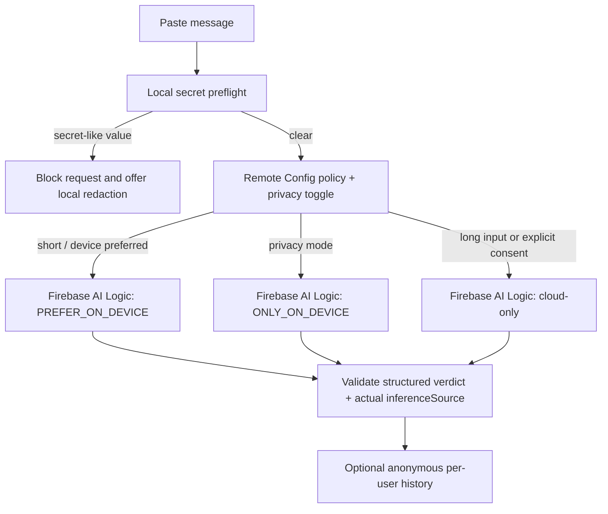

# Jeda

**Pause before you connect.** Jeda is a privacy-first crypto-message triage prototype that helps people spot common scam signals without connecting a wallet. It uses Vite + TypeScript and Firebase AI Logic hybrid inference.

## Value proposition

- **For** everyday crypto and NFT users who receive airdrop claims, "official support" DMs, recovery offers, and wallet approval requests.
- **The problem:** these scams rush people into connecting a wallet, approving a spending permission, or sharing a recovery phrase before they check.
- **What makes Jeda different:**
  - It runs on the device first (`PREFER_ON_DEVICE`, or `ONLY_ON_DEVICE` in Privacy mode) and only uses the cloud when the SDK falls back or the user approves it.
  - It blocks seed phrases and private-key-like values locally, before any model runs.
  - It never connects a wallet, signs a transaction, or opens links from a message.

## Problem & audience

Everyday crypto and NFT users encounter urgent DMs, fake airdrops, support impersonation, recovery offers, and wallet approval requests in social feeds and community chats. These attacks push people to act before verifying permissions or contacting official support. Jeda helps a user inspect message text at that decision point. Local-first processing matters because pasted messages may contain personal context and network access can be unreliable. This is heuristic text triage only: it does not inspect contracts or transactions, verify URLs or wallet addresses, detect every scam, or guarantee that an action is safe.

## Architecture



- `src/secret-guard.ts` checks input before any Firebase call or write; `src/policy.ts` implements routing, confidence escalation, and bounded verdict validation.
- `src/firebase.ts` initializes Firebase, App Check, Remote Config, AI Logic hybrid models, anonymous Auth, and user-scoped Firestore history. `modelFor()` calls `getGenerativeModel()` with the selected `InferenceMode`, a shared system instruction, cloud `responseSchema`, and on-device `responseConstraint`. `analyze()` calls `initializeDeviceModel()` when needed, invokes `generateContent()`, validates with `parseVerdict()`, and returns the SDK's actual `response.inferenceSource`.
- `src/main.ts` renders the browser app and evaluation harness. Its hybrid console ("Where your checks ran") counts completed checks by the SDK's `response.inferenceSource` and counts secret-guard blocks; the counters live in memory for the current tab only. The model is created and called only in the user's action flow. No wallet provider, transaction signing, URL fetching, multimodal input, or server-side model proxy is included.
- `public/eval/cases.json` is the synthetic labeled set; `docs/threat-model.md` and `MANUAL_STEPS.md` cover limitations and setup.

## Run locally

Requirements: Node 24.12 or newer (the Firebase 13 packages declare it) and pnpm. Verified with Node 24.16 and pnpm 10.34.

1. **Install dependencies.**
   ```bash
   pnpm install
   ```
   If pnpm reports ignored build scripts (for example `ERR_PNPM_IGNORED_BUILDS` or "Ignored build scripts: esbuild, @firebase/util, protobufjs"), run the command below, approve those three packages, and continue. The packages are already installed either way.
   ```bash
   pnpm approve-builds
   ```
   npm also works (`npm install`). The included `.npmrc` sets `legacy-peer-deps=true` because npm 10 crashes (`Cannot read properties of null (reading 'edgesOut')`) while resolving Firebase's optional peer dependencies.
2. **Create `.env.local` from the template.**
   ```bash
   cp .env.example .env.local
   ```
   Fill in the values from Firebase Console → Project settings → General → Your apps → Web app:

   | Variable | Where it comes from |
   | --- | --- |
   | `VITE_FIREBASE_API_KEY` | Web app config `apiKey` |
   | `VITE_FIREBASE_AUTH_DOMAIN` | Web app config `authDomain` |
   | `VITE_FIREBASE_PROJECT_ID` | Web app config `projectId` |
   | `VITE_FIREBASE_APP_ID` | Web app config `appId` |
   | `VITE_FIREBASE_MESSAGING_SENDER_ID` | Web app config `messagingSenderId` |
   | `VITE_RECAPTCHA_SITE_KEY` | App Check → reCAPTCHA Enterprise site key (public) |
   | `VITE_APPCHECK_DEBUG` | `false`; set `true` only in a development Firebase project |

   `.env.local` is ignored by Git. Never commit it, private keys, or service-account credentials. Without these values the app still runs as a demo workspace, with model calls and history disabled.
3. **Configure Firebase.** Follow `MANUAL_STEPS.md` to enable Anonymous Authentication, Firestore (deploy `firestore.rules`), Firebase AI Logic (Gemini Developer API backend), Remote Config (values from `remoteconfig.defaults.json`), and App Check.
4. **Start the dev server.**
   ```bash
   pnpm dev
   ```
   Open `http://localhost:3000` in desktop Chrome. For on-device inference, see "Enable Gemini Nano" on the How it works page.
5. **Run the checks.**
   ```bash
   pnpm test
   pnpm build
   ```

Firebase web configuration is public client configuration, not a secret. Protect project resources with Authentication, least-privilege Firestore rules, App Check, and Firebase API restrictions. The included `firebase.json` configures static Hosting and Firestore rules.

## Inference policy

Firebase JS SDK **12.5.0 or newer** is needed for hybrid inference; this app uses the current SDK 13.4.0. `defaultMode` from Remote Config controls normal routing, defaulting to `PREFER_ON_DEVICE`. The SDK's `response.inferenceSource`—not a guess from the selected mode—drives the displayed source badge and evaluation results. **`PREFER_ON_DEVICE` allows SDK cloud fallback if an on-device model is unavailable.** Privacy mode overrides this with `ONLY_ON_DEVICE`; if that fails, the text is not sent, and the user may separately approve cloud-only review. Over-limit text uses cloud-only mode only after the user clicks Check, with a visible notice. Low-confidence output offers one separate, explicitly confirmed cloud review. The app initializes the device model from the user action and displays its download progress.

Firebase's current Web hybrid-inference documentation supports sequential calls with different `InferenceMode` values, structured output constraints, `generateContentStream()`, and text-plus-PNG/JPEG on-device input in supported Chrome environments. This app uses text-only structured output and non-streaming `generateContent()` because each check returns one compact verdict; it does not need image analysis or token streaming. The source badge is taken from `response.inferenceSource`, not inferred from the requested mode.

| Condition | Requested mode | Behavior |
| --- | --- | --- |
| Short input, standard mode | Remote Config `defaultMode` (default `PREFER_ON_DEVICE`) | Prefer local model; Firebase may fall back to cloud. Actual source is shown. |
| Privacy mode | `ONLY_ON_DEVICE` | Never falls back; failure does not send text. Cloud alternative requires a separate consent action. |
| Input over `maxOnDeviceChars` | `ONLY_IN_CLOUD` | Cloud request starts only after Check is pressed and is disclosed in the UI. |
| Low-confidence local result | `ONLY_IN_CLOUD` | A separate cloud second opinion is offered with explicit consent; both results remain visible. |

Low confidence is defined in `src/policy.ts`: invalid/missing schema, risk `medium`, fewer than `lowConfidenceThreshold` flags, or model uncertainty at least `0.55`. Remote Config keys: `defaultMode` (one of four Firebase `InferenceMode` values), `maxOnDeviceChars` (validated integer 100–6000), `escalationEnabled` (boolean), and `lowConfidenceThreshold` (validated integer 0–8). Client-side settings are not a security boundary; App Check and Firestore Rules protect Firebase resources.

## Privacy and safety

- A local preflight scan runs before model calls or writes. It blocks private-key-like 64-hex values (with or without `0x`) and recovery-phrase-like word runs: 12 or more consecutive words (3-8 letters, case-insensitive) where at least 10 of every 12 are on the English BIP-39 wordlist. That covers all five BIP-39 lengths (12, 15, 18, 21, 24) and tolerates up to two typos. Items may be separated by spaces, commas, semicolons or new lines and may carry numbering such as `1.`, `1)` or `(1)`; the whole phrase is redacted, including adjacent wordlist words. Ordinary sentences are not flagged because they rarely match the wordlist that densely. It does not validate the BIP-39 checksum or cover non-English wordlists, and a 64-character transaction hash is still blocked because it looks identical to a private key.
- The analyzer never connects to a wallet, signs transactions, browses provided URLs, or executes pasted text.
- History is scoped to an anonymous Firebase UID. Only summary metadata is saved by default; storing raw text is opt-in. Users can clear their own records.
- Output is heuristic guidance, not a guarantee. Verify through official channels; a message can be malicious even when the model reports low risk.

## Evaluation

`public/eval/cases.json` contains 40 synthetic examples (20 scams across six categories and 20 benign messages, including look-alikes). Open Evaluation and confirm the consent prompt. The harness initializes `PREFER_ON_DEVICE` from the click flow, then runs every case in `PREFER_ON_DEVICE` and `ONLY_IN_CLOUD` modes. Reports include measured mode and actual-source accuracy, false-negative rate, p50 latency, cloud fallback count/rate, actual cloud second-opinion trigger count/rate and outcomes, per-case outputs, and errors. Reports never include case text. The app view starts empty because `evaluation-results.json` contains only `[]`; the cloud second-opinion count/rate reflects additional `ONLY_IN_CLOUD` calls actually made for low-confidence on-device results after the benchmark's single consent prompt. Use Download JSON and `pnpm record-eval jeda-evaluation-results.json` to append a real run. Review it before committing. No results are fabricated. The data is a prototype smoke-test set, not a production security benchmark. Compare runs under the same browser, model, Firebase region, SDK, and network conditions.

## Testing instructions for judges

No login, wallet, or real data is needed. Every example in the app is synthetic.

1. **Open the hosted site:** https://jeda-dev.web.app. Use desktop Chrome.
2. **Use "Quick tour for judges"** above the checker. Its four buttons set up each step below; nothing is sent to a model until you click **Check this message**.
3. **01 Scam verdict.** Loads the synthetic "Claim your airdrop" message. Click **Check this message**. The result panel shows a risk level, the signals found, one safe next step, and a badge that says where the model ran.
4. **02 Secret guard.** Turns on **Privacy mode** (on-device only) and pastes this synthetic seed phrase: `apple river stone cloud maple tiger lemon ocean pencil garden window silver`. Jeda blocks the check before any model runs and shows a warning with a **Redact and continue** button. Click it to replace the phrase with `[RECOVERY PHRASE REDACTED]`.
5. **03 Second opinion.** Loads the synthetic "Routine approval" message. Click **Check this message**. If the on-device result is low-confidence, Jeda offers a cloud second opinion that runs only after you confirm.
6. **04 Evaluation.** Opens the Evaluation page, which lists the 40 synthetic test cases and stays empty until a real run is recorded. History is anonymous and stores metadata only by default.
7. **Read the hybrid console.** "Where your checks ran", below the checker, counts the checks in this tab that ran on-device, ran in the cloud, or were stopped by the secret guard, and marks the path of the latest one with "Ran here". The counts start at zero and are not stored.

Where inference runs:

- On-device inference needs desktop Chrome with the local model (Gemini Nano) downloaded. See "Enable Gemini Nano" on the How it works page.
- Without a local model, standard mode (`PREFER_ON_DEVICE`) lets the Firebase SDK use the cloud model, following its hybrid inference policy. Privacy mode (`ONLY_ON_DEVICE`) never falls back on its own; it shows an error and offers a separately confirmed cloud request.
- The badge under each result ("Ran on-device" or "Ran in cloud") comes from the SDK's `response.inferenceSource`, so it always shows where the result was actually produced.
- When the code runs without Firebase values (for example a fresh local clone), the app opens as a "Demo workspace": the secret guard, routing notice, and all pages work, but model calls and history are disabled.

## Full Firebase walkthrough

1. Configure Firebase and App Check using [MANUAL_STEPS.md](MANUAL_STEPS.md); the app deliberately keeps cloud inference and history disabled until App Check initializes.
2. Use desktop Chrome 139+ and enable `chrome://flags/#prompt-api-for-gemini-nano-multimodal-input`. Open Jeda once while online to download the local model, then try a short synthetic case. The badge reports the actual SDK source.
3. Turn on Privacy mode and confirm a local result. With the model unavailable, confirm the error says the text was not sent; an explicitly approved cloud fallback is available only when App Check is ready.
4. Turn off Privacy mode, and use an over-limit synthetic message or set Remote Config `defaultMode=ONLY_IN_CLOUD` to see the cloud path. Use a low-confidence local result to test the separately confirmed second opinion.
5. Run checks with `pnpm test` and `pnpm build`. Do not publish evaluation metrics until a real report has been generated and reviewed.

## Deploy to Firebase Hosting

`firebase.json` serves the Vite build from `dist/` with a single-page rewrite to `/index.html`, baseline security headers, and the Firestore rules.

1. Install the Firebase CLI and sign in: `npm install -g firebase-tools`, then `firebase login`.
2. Select your project: `firebase use --add` (this writes `.firebaserc`, which holds only the project ID).
3. Fill in `.env.local` first, because Vite embeds the public web-app values at build time. Then build:
   ```bash
   pnpm build
   ```
4. Deploy:
   ```bash
   firebase deploy --only hosting
   firebase deploy --only firestore:rules
   ```
5. After the first deploy, lock the project to the hosting domain:
   - **App Check:** add the hosting domains (`<project-id>.web.app`, `<project-id>.firebaseapp.com`, and any custom domain) to the allowed domains of the reCAPTCHA Enterprise key used by App Check (Google Cloud Console → Security → reCAPTCHA). Verify requests in App Check monitoring, then enforce App Check for Firebase AI Logic and Cloud Firestore.
   - **API key:** in Google Cloud Console → APIs & Services → Credentials, edit the Firebase browser key. Under Application restrictions choose "Websites" and list the same domains (add `localhost` only in a separate development project). Under API restrictions, allow only the Firebase APIs the app uses.

No keys are stored in this repository. Do not commit `.env.local` or `.firebaserc` values you consider private.

## Known limitations

On-device inference requires a supported desktop Chrome version, enabled Prompt API flag, a downloaded model, and suitable device resources. The model is not guaranteed to work offline until it has been initialized while online. Firebase cloud inference requires project setup, billing/backend access as applicable, and enforced App Check. The local secret detector matches words against the English BIP-39 list; it does not validate the mnemonic checksum or cover other languages. The classifier and synthetic evaluation corpus are not security audits or production benchmarks.

## Assets

- **No third-party image assets are used.** The app ships no photos, illustrations, or image files. The hero, the example message and assessment cards, the empty result state, and the onboarding header are built with HTML, CSS and a small canvas animation.
- Icons are inline SVG paths written in `src/main.ts`, and the favicon is an inline SVG data URI in `index.html`.
- The UI uses no third-party logos, ads, or brand marks. Technology names such as Firebase AI Logic appear as plain text only.
- The Geist, Geist Mono and Instrument Serif fonts (SIL Open Font License) are self-hosted from the `@fontsource-variable/geist`, `@fontsource-variable/geist-mono` and `@fontsource/instrument-serif` npm packages and bundled by Vite. The app makes no request to Google Fonts.
- The interface style is layered in four files: `src/style.css` (layout and components), `src/theme-glass.css` (translucent cards over slow-moving background light, dot-matrix numerals, and a dark mode that spreads from the theme button using the View Transitions API), `src/theme-elegant.css` (serif headings and refined spacing), and `src/motion-dashboard.css` with `src/motion-dashboard.ts` (the animated hero dashboard, drawn with a canvas and DOM). Every number on that dashboard is synthetic and is labeled "Demo workspace, synthetic data" in the interface. Motion is disabled when the system asks for reduced motion.
- `src/bip39-english.ts` contains the English BIP-39 wordlist from [bitcoin/bips](https://github.com/bitcoin/bips/blob/master/bip-0039/english.txt) (MIT licensed). It is used only by the local secret guard.
- `devpost-assets/` holds the Devpost cover image (`jeda-hero-1200x630.png`) and five screenshots captured from this app running in Chrome: desktop, mobile, dark mode, the secret guard blocking a synthetic seed phrase, and the hybrid console. They were taken in the demo workspace without Firebase keys, so none of them shows a model result; the console screenshot shows one secret-guard block and zero model runs. Add a capture from a configured project to show a real assessment.

## Project and submission materials

- Source repository: <https://github.com/zorumeon/jeda>
- [Submission checklist](SUBMISSION_CHECKLIST.md)
- [Demo recording script](DEMO_SCRIPT.md)
- [Devpost draft](DEVPOST.md)
- [Manual Firebase setup](MANUAL_STEPS.md)
- [Threat model](docs/threat-model.md)
- [Firebase setup checklist](docs/firebase-setup.md)
- Devpost images and screenshots of the running app (demo workspace, no Firebase credentials): `devpost-assets/`
- License: Apache-2.0 (`LICENSE`)
